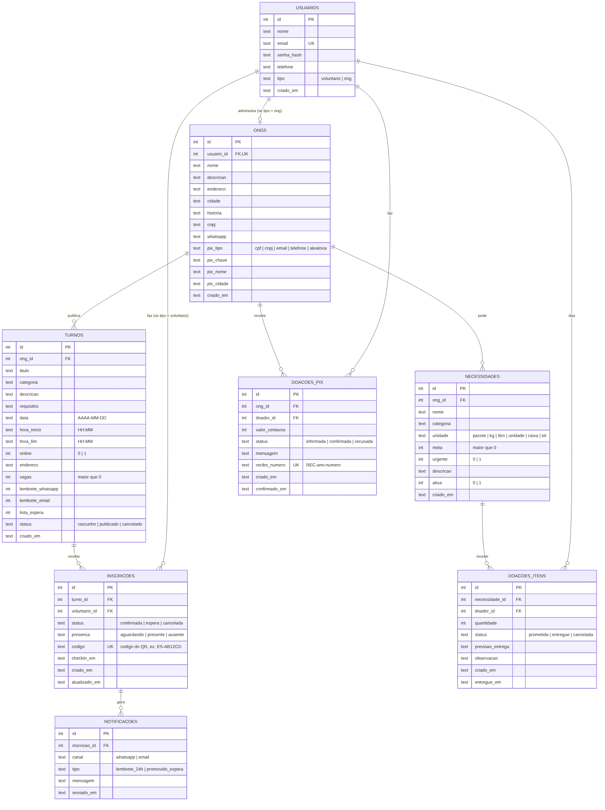

# Escala Solidária

Sistema web para **ONGs organizarem voluntariado e doações**. A ONG publica turnos com vagas e uma lista do que precisa receber. A comunidade, pelo celular, se inscreve nos turnos, doa itens ou faz PIX. O sistema faz o check-in por QR Code, emite recibo em PDF de cada PIX confirmado, guarda o histórico de quantas vezes cada pessoa ajudou e liga doador e ONG direto pelo WhatsApp.

O caso de uso de demonstração é a **Associação Girassol Azul**, uma creche inclusiva **fictícia** para crianças autistas. A pasta `materiais/` traz o kit de extensão: história da ONG, panfleto, infográfico, cartilha, e-book, plano de capacitação, certificados, declaração e campanha.

> Projeto acadêmico: Node.js + Express + SQLite, com front-end em HTML, CSS e JavaScript puros.

---

## Funcionalidades

**Voluntário (app para celular)**
- Cadastro e login
- Lista de turnos futuros com busca e filtro por categoria
- Detalhe do turno, com inscrição ou cancelamento
- Lista de espera automática quando o turno lota (se a ONG ativou essa opção)
- "Meus turnos", com as abas próximos e histórico e o total de horas doadas no ano
- QR Code de check-in, com código manual de reserva (ex.: `ES-AB12CD`)
- Certificado de horas, que pode ser impresso ou salvo em PDF pelo navegador

**Doador (app para celular)**
- Lista de ONGs com pedidos de doação (urgentes primeiro)
- Página da ONG com história, lista de necessidades com metas e barra de progresso (recebido × prometido)
- Doação de itens: escolhe quantidade e data e combina a entrega pelo WhatsApp, com a mensagem já escrita
- Doação via PIX: escolhe o valor, o app gera o **QR Code PIX** e o código copia-e-cola (padrão BR Code do Banco Central) e o doador avisa "Já fiz o PIX"
- "Minhas doações": **quantas vezes já ajudou**, total doado, recibo em PDF de cada PIX confirmado e **declaração anual** em PDF

**ONG (painel web, também funciona no celular)**
- Painel com indicadores: turnos da semana, confirmados, taxa de presença e horas no mês
- Criação, edição e cancelamento de turnos, além de rascunhos
- Lista de presença com check-in por código, presença ou falta marcada manualmente e opção de desfazer
- Exportação da lista de presença em CSV (abre no Excel)
- Atividade recente: inscrições, cancelamentos e check-ins
- Perfil público com história, WhatsApp e **chave PIX** (CNPJ, CPF, e-mail, telefone ou aleatória), além de um QR de teste
- Lista de necessidades: criar, editar, marcar como urgente, encerrar e reabrir
- Conferência de PIX (confirmar ou "não localizei"), com recibo numerado `REC-ano-número`
- Registro de itens recebidos, com botão de WhatsApp para falar com cada doador

**Regras de negócio**
- Não é possível se inscrever duas vezes no mesmo turno.
- Com o turno lotado, o voluntário entra na lista de espera ou recebe o aviso "Turno lotado".
- Quando alguém cancela, o primeiro da lista de espera é promovido e notificado.
- A ONG não pode reduzir as vagas abaixo do número de confirmados.
- Não é possível cancelar a inscrição depois que o turno começou.
- Só contam como horas doadas os turnos com **presença confirmada**.
- Uma ONG não consegue ver nem alterar os turnos de outra ONG.
- Lembretes são registrados 24h antes do turno, por WhatsApp e/ou e-mail (veja as limitações).
- O PIX cai **direto na conta da ONG**: o sistema não movimenta dinheiro. O recibo só é liberado depois que a ONG confere o extrato e confirma.
- Um PIX confirmado não pode ser desfeito, porque o recibo já foi emitido.
- O doador só cancela uma doação de item enquanto ela ainda não foi entregue.

---

## Como rodar

**Pré-requisitos:** [Node.js](https://nodejs.org) **22.13 ou superior**. A versão LTS atual serve. Confira com `node -v`.

O banco usa o SQLite que já vem dentro do Node (`node:sqlite`). Por isso não é preciso instalar banco de dados nem compilar nenhum driver.

```bash
# 1. Instalar as dependências
npm install

# 2. Criar o banco com dados de demonstração
npm run seed

# 3. Iniciar o servidor
npm start
```

Depois é só abrir **http://localhost:3000** no navegador.

### Usuários de teste

A senha de todos é `123456`.

| Perfil      | E-mail                | Observação                                   |
|-------------|-----------------------|----------------------------------------------|
| ONG         | `ong@demo.com`        | Associação Girassol Azul, creche inclusiva fictícia (turnos, necessidades, PIX a confirmar) |
| Voluntário/doador | `voluntario@demo.com` | Mariana Souza (horas, 3 PIX confirmados, recibos, doações de itens) |

Outras ONGs: `mesa@demo.com`, `vestir@demo.com`, `aprender@demo.com`, `peludos@demo.com`. Outros voluntários: `vol1@demo.com` a `vol8@demo.com`.

> **Atenção:** telefones, endereço e chave PIX dos dados de demonstração são **fictícios**. Antes de usar com uma ONG real, cadastre os dados verdadeiros em *Perfil, PIX e WhatsApp*.

> **Dica para a apresentação:** abra o voluntário numa janela normal e a ONG numa janela anônima. Assim as duas sessões ficam abertas ao mesmo tempo. Com o QR na tela do voluntário, registre o check-in pelo painel da ONG digitando o código, e a tela do voluntário atualiza sozinha em até 10 segundos.

### Comandos

| Comando        | O que faz                                                |
|----------------|----------------------------------------------------------|
| `npm start`    | Inicia o servidor na porta 3000 (ou na variável `PORT`)  |
| `npm run dev`  | Inicia o servidor e reinicia quando um arquivo muda      |
| `npm run seed` | **Apaga** o banco e recria com os dados de demonstração  |
| `npm test`     | Roda os testes automatizados                             |

---

## Estrutura do projeto

```
escala-solidaria/
├── src/
│   ├── server.js            # Inicia o servidor e o verificador de lembretes
│   ├── app.js               # Configura o Express (sessão, rotas, erros)
│   ├── db.js                # Conexão SQLite (node:sqlite) e criação das tabelas
│   ├── seed.js              # Dados de demonstração
│   ├── utils.js             # Datas, validação, geração de código
│   ├── rotas/
│   │   ├── auth.js          # Cadastro, login, logout, middleware de permissão
│   │   ├── voluntario.js    # Turnos públicos, inscrição, "meus turnos", QR
│   │   ├── ong.js           # Painel, CRUD de turnos, presença, check-in, CSV
│   │   └── doacoes.js       # ONGs, necessidades, doações de itens e PIX, recibos
│   └── servicos/
│       ├── inscricoes.js    # Regras de inscrição, cancelamento, lista de espera
│       ├── lembretes.js     # Lembretes de 24h (envio simulado)
│       ├── pix.js           # BR Code (PIX copia-e-cola) com CRC16
│       ├── recibos.js       # Recibo e declaração anual em PDF (pdfkit)
│       └── extenso.js       # Valor por extenso no recibo
├── public/                  # Front-end (servido como arquivos estáticos)
│   ├── index.html           # 1. Entrar / criar conta
│   ├── turnos.html          # 2. Turnos disponíveis
│   ├── turno.html           # 3. Detalhe e inscrição
│   ├── meus-turnos.html     # 4. Meus turnos e horas
│   ├── checkin.html         # 5. QR Code de check-in
│   ├── certificado.html     # Certificado para imprimir/PDF
│   ├── doar.html            # ONGs que pedem doação
│   ├── ong-perfil.html      # Página pública da ONG: necessidades, PIX, WhatsApp
│   ├── minhas-doacoes.html  # Histórico, recibos e declaração anual
│   ├── ong/
│   │   ├── painel.html      # 6. Painel da ONG
│   │   ├── novo-turno.html  # 7. Criar/editar turno
│   │   ├── presenca.html    # 8. Lista de presença
│   │   ├── turnos.html      # Todos os turnos da ONG
│   │   ├── doacoes.html     # PIX, itens doados e lista de necessidades
│   │   └── perfil.html      # Perfil, chave PIX e WhatsApp
│   ├── css/app.css
│   └── js/api.js            # Funções compartilhadas (fetch, formatação, menus)
├── tests/
│   ├── api.test.js          # Testes de voluntariado (Jest + Supertest)
│   └── doacoes.test.js      # Testes de doações, PIX e recibos
├── materiais/               # Kit de extensão (PDFs, posts e versões editáveis)
├── docs/
│   ├── modelo-banco.mmd     # Diagrama ER (Mermaid)
│   └── modelo-banco.png     # Diagrama ER (imagem)
└── data/escala.db           # Banco SQLite (criado automaticamente)
```

---

## Modelo do banco de dados



| Tabela         | Para que serve |
|----------------|----------------|
| `usuarios`     | Login de voluntários e responsáveis de ONG (campo `tipo`) |
| `ongs`         | Dados da ONG, ligada 1:1 ao usuário responsável |
| `turnos`       | Turnos publicados pela ONG: data, horário, vagas e opções de lembrete e lista de espera |
| `inscricoes`   | Relação voluntário × turno (N:N): status da inscrição, presença e código do QR |
| `notificacoes` | Histórico dos lembretes e avisos enviados. `UNIQUE` impede o envio duplicado |
| `necessidades` | Itens que a ONG precisa, com categoria, unidade, meta e indicação de urgência |
| `doacoes_itens` | Doação de itens: quem doou, quanto e o status (prometida, entregue ou cancelada) |
| `doacoes_pix`  | Doação via PIX: valor em centavos, status (informada, confirmada ou recusada) e número do recibo |

O código-fonte do diagrama fica em `docs/modelo-banco.mmd`. O GitHub e o VS Code (com extensão de Mermaid) mostram o diagrama direto.

---

## API (resumo)

Todas as rotas usam JSON e sessão por cookie. Os erros voltam como `{ "erro": "mensagem" }`.

| Método | Rota | Quem | Descrição |
|---|---|---|---|
| POST | `/api/auth/register` | público | Cria conta (`tipo`: `voluntario` ou `ong`) |
| POST | `/api/auth/login` | público | Entra |
| POST | `/api/auth/logout` | logado | Sai |
| GET | `/api/auth/me` | logado | Usuário da sessão |
| GET | `/api/turnos?categoria=&q=` | público | Turnos futuros publicados |
| GET | `/api/turnos/:id` | público | Detalhe do turno |
| POST | `/api/turnos/:id/inscricao` | voluntário | Inscreve (confirmada ou espera) |
| DELETE | `/api/turnos/:id/inscricao` | voluntário | Cancela a inscrição |
| GET | `/api/me/inscricoes` | voluntário | Próximos e histórico |
| GET | `/api/me/resumo?ano=` | voluntário | Horas, turnos e ONGs no ano |
| GET | `/api/me/inscricoes/:id/checkin` | voluntário | Código e QR Code (imagem base64) |
| GET | `/api/ong/painel` | ONG | Indicadores, próximos turnos, atividade |
| GET/POST | `/api/ong/turnos` | ONG | Lista / cria turno |
| GET/PUT | `/api/ong/turnos/:id` | ONG | Detalhe / edita turno |
| POST | `/api/ong/turnos/:id/cancelar` | ONG | Cancela turno |
| GET | `/api/ong/turnos/:id/presenca` | ONG | Lista de presença com resumo |
| GET | `/api/ong/turnos/:id/presenca-csv` | ONG | Exporta CSV |
| PATCH | `/api/ong/inscricoes/:id/presenca` | ONG | Marca `presente`, `ausente` ou `aguardando` |
| POST | `/api/ong/checkin` | ONG | Check-in pelo código do QR |
| GET | `/api/ongs` | público | ONGs com pedidos de doação |
| GET | `/api/ongs/:id` | público | Perfil, necessidades com progresso e estatísticas |
| GET | `/api/ongs/:id/pix?valor=` | público | PIX copia-e-cola e QR Code |
| POST | `/api/necessidades/:id/doacoes` | doador | Promete doação de item |
| POST | `/api/ongs/:id/doacoes-pix` | doador | Informa um PIX feito |
| GET | `/api/me/doacoes` | doador | Resumo (vezes que ajudou), PIX e itens |
| DELETE | `/api/me/doacoes-itens/:id` | doador | Cancela doação ainda não entregue |
| GET | `/api/me/doacoes-pix/:id/recibo` | doador | Recibo em PDF |
| GET | `/api/me/doacoes/declaracao?ano=` | doador | Declaração anual em PDF |
| GET/PUT | `/api/ong/perfil` | ONG | Perfil, WhatsApp e chave PIX |
| GET/POST | `/api/ong/necessidades` | ONG | Lista / cria necessidade |
| PUT | `/api/ong/necessidades/:id` | ONG | Edita necessidade |
| POST | `/api/ong/necessidades/:id/encerrar` · `/reabrir` | ONG | Encerra ou reabre |
| GET | `/api/ong/doacoes` | ONG | PIX e itens recebidos, com resumo |
| PATCH | `/api/ong/doacoes-pix/:id` | ONG | Confirma ou recusa PIX |
| PATCH | `/api/ong/doacoes-itens/:id` | ONG | Marca item como entregue ou cancelado |
| GET | `/api/ong/doacoes-pix/:id/recibo` | ONG | Recibo em PDF |

---

## Testes

```bash
npm test
```

São 34 testes automatizados, todos rodando num banco em memória. Eles cobrem:

- cadastro, login, validações e rotas protegidas
- permissões: voluntário não cria turno, e uma ONG não acessa a outra
- inscrição, duplicidade, lotação, lista de espera e promoção automática
- check-in por código, presença manual, horas no certificado e exportação CSV
- lembretes de 24h sem envio duplicado
- PIX: CRC16 conferido com o exemplo oficial do Banco Central, valor, acentos e validação de chaves
- doação de itens com metas, confirmação de PIX, recibo e declaração em PDF, contagem de "vezes que ajudou" e permissões
- valor por extenso no recibo

---

## Limitações conhecidas (e ideias de evolução)

- **Lembretes simulados.** A mensagem é gravada na tabela `notificacoes` e impressa no console do servidor. Para enviar de verdade, basta trocar a função `enviar` em `src/servicos/lembretes.js` por uma integração: API oficial do WhatsApp Business, Twilio, ou Nodemailer com SMTP para e-mail.
- **Leitura do QR pela câmera.** Por enquanto a ONG digita o código que aparece abaixo do QR. Como evolução, dá para usar uma biblioteca como `html5-qrcode` e ler direto pela câmera do celular.
- **Sessões em memória.** Reiniciar o servidor desloga todo mundo. Em produção, use um store persistente (ex.: `connect-sqlite3`) e defina a variável `SESSION_SECRET`.
- **SQLite nativo do Node.** O módulo `node:sqlite` ainda é marcado como "experimental" pelo Node. Funciona bem para este projeto, mas nos testes pode aparecer um aviso amarelo no terminal, que pode ser ignorado.
- **PIX sem confirmação automática.** Com PIX estático, o banco não avisa o sistema quando o dinheiro cai, então a ONG confere o extrato. Para confirmar automaticamente, seria preciso usar a API PIX de um banco ou intermediador (PIX dinâmico com webhook).
- **Recibo não é documento fiscal.** O texto do PDF deixa isso claro. A dedução no IR depende da entidade e do doador.
- **Fonte.** O layout usa a fonte Plus Jakarta Sans do Google Fonts. Sem internet, o navegador usa a fonte do sistema e tudo continua funcionando.
- **Fuso horário.** As datas usam a hora local do servidor, o que basta para uma ONG local.
- **Próximos passos sugeridos:** recuperação de senha, perfil do voluntário, mapa com distância até o turno, avaliação do turno pelo voluntário e relatórios mensais para a ONG.
